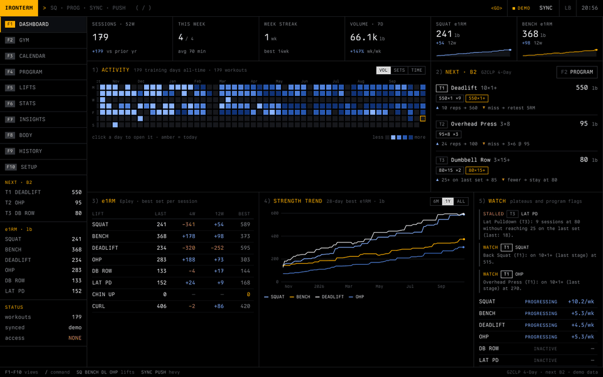
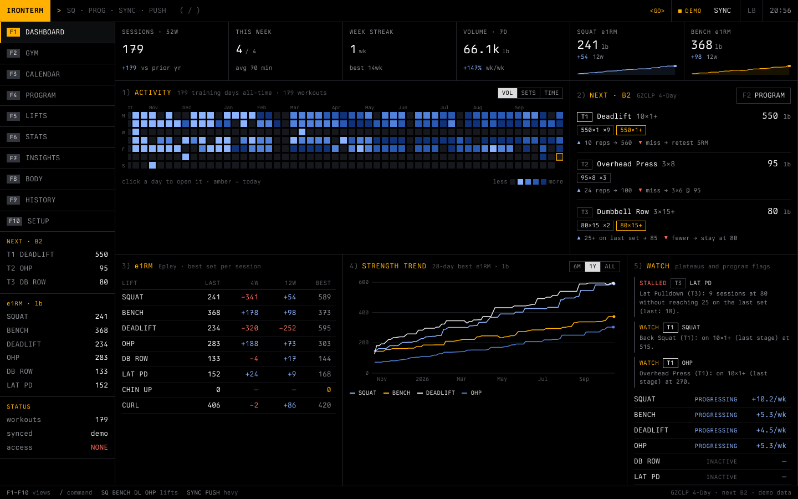
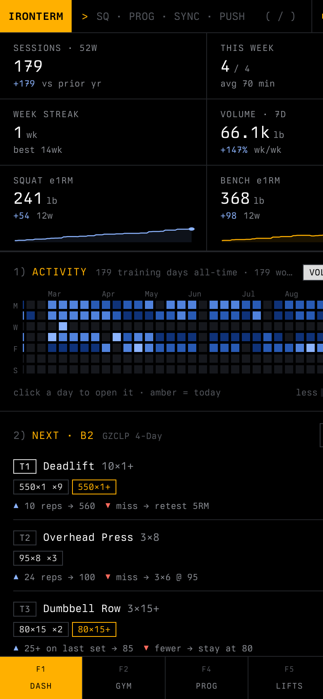
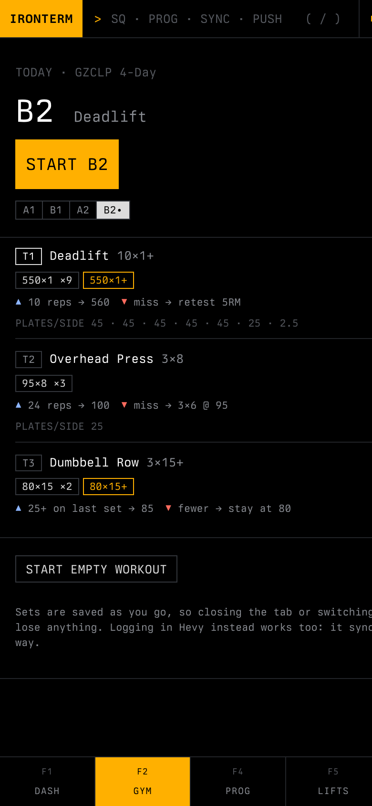
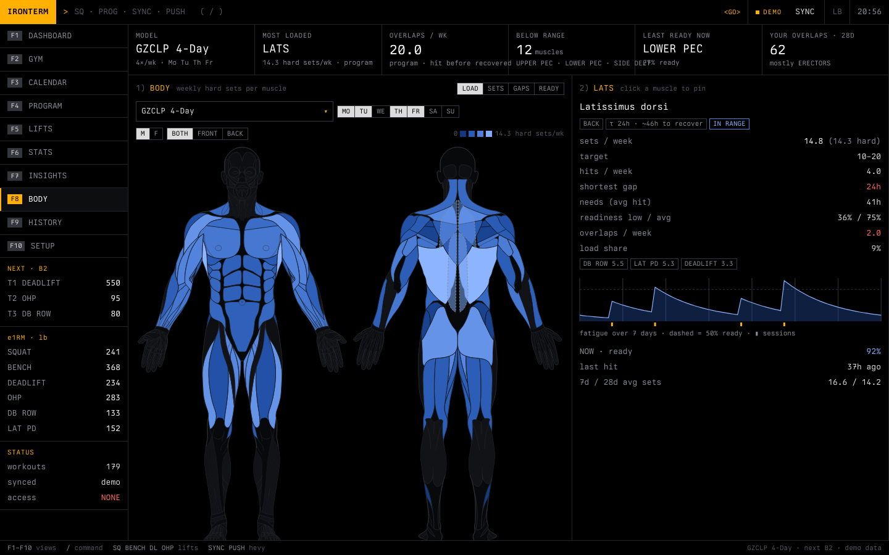
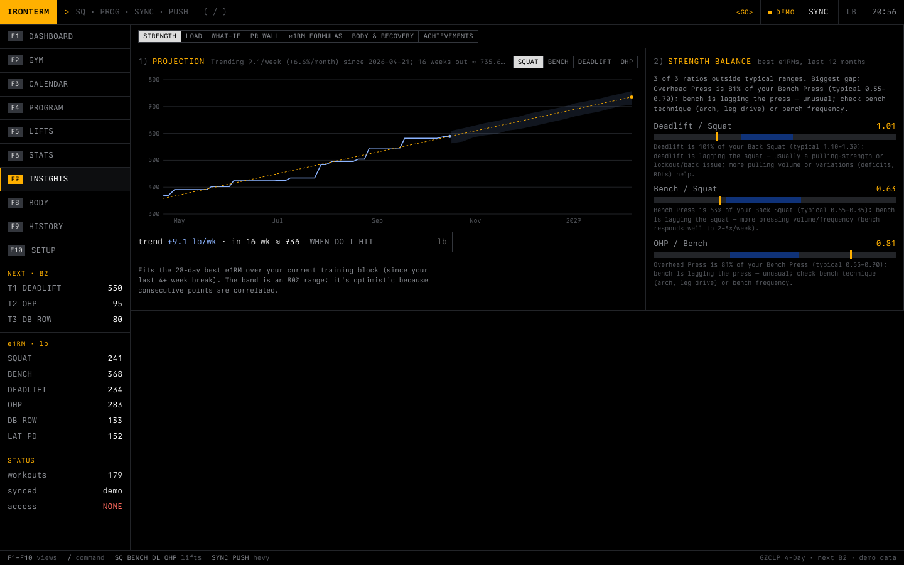
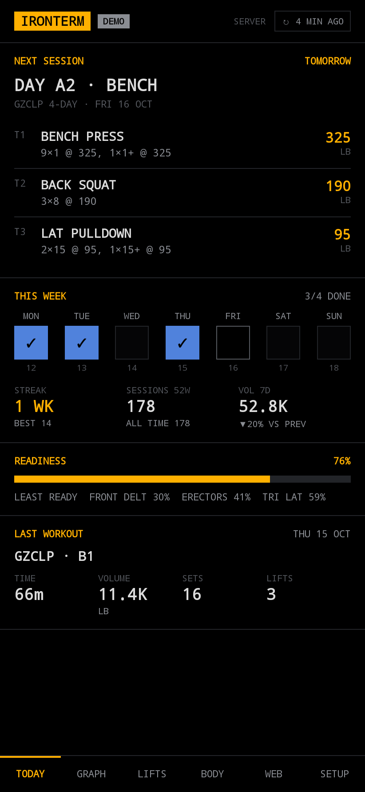
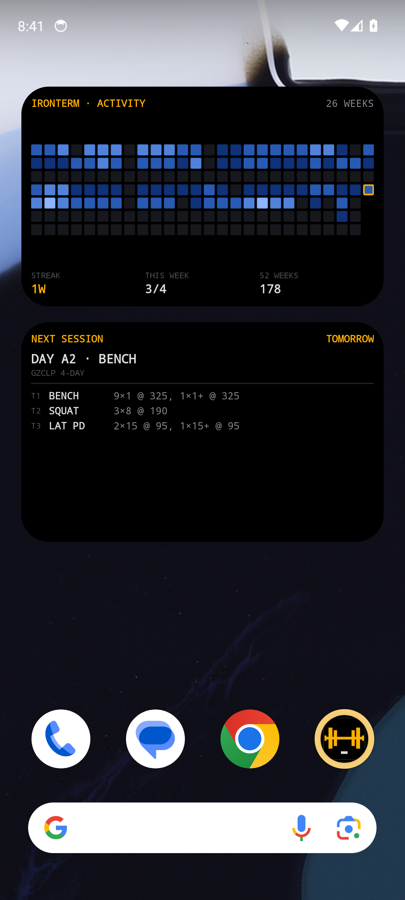
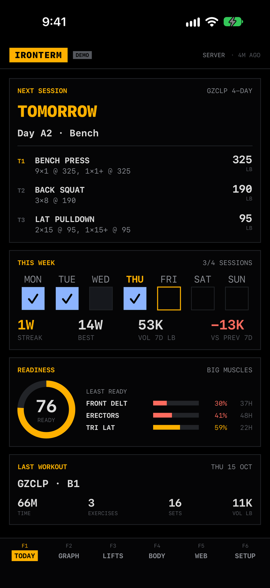
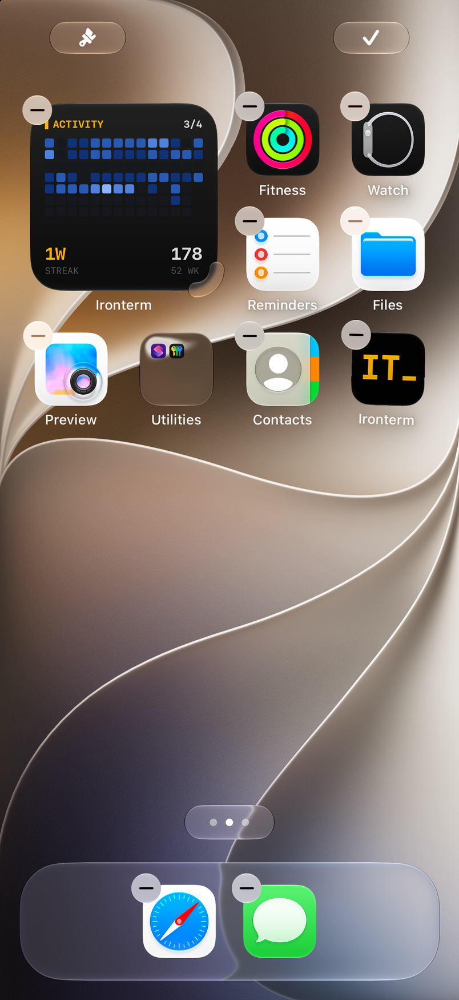

<div align="center">

# IRONTERM

**A Bloomberg-terminal for your lifting.** A web app, Android and iOS apps, and home-screen widgets for people who log their training in [Hevy](https://hevy.com).

[](https://github.com/Rjected/ironterm/actions/workflows/web.yml)
[](https://github.com/Rjected/ironterm/actions/workflows/android.yml)
[](https://github.com/Rjected/ironterm/actions/workflows/ios.yml)
[](https://github.com/Rjected/ironterm/actions/workflows/cli.yml)
[](LICENSE)



</div>

> **Unofficial.** Ironterm uses Hevy's public API with *your own* API key. It is not affiliated with or endorsed by Hevy. Ironterm has no backend of its own: you run the server, or use the phone apps on their own.

## What it does

- **Runs your program from your real log.** It includes ~60 templates: GZCLP and the GZCL family, 5/3/1 variants, nSuns, Sheiko, Candito, Calgary Barbell, SBS, Smolov, and more. Your Hevy history is replayed through the program's rules, so the weights pick up where you actually are. You can push the next sessions to Hevy as routines, or log them in the app's own **gym mode** and save the workout to Hevy.
- **The year at a glance.** A GitHub-style contribution graph, streaks, volume, e1RM trends, PR walls, and stalls caught early.
- **Body map.** Per-muscle weekly load and recovery from a detailed anatomical figure (male / female), with overlaps where a muscle is hit before it has recovered.
- **Nerd stuff.** e1RM formula shootout, INOL / Prilepin, lift ratios, strength projections, landmarks, sleep and recovery vs. performance (WHOOP), and program what-ifs.
- **Life happens.** A calendar, trips that pause your program instead of failing it, hotel-gym sessions, and a re-entry ramp after a break.
- **Notes** on workouts and exercises, synced back to Hevy.
- **Phone apps and widgets.** Activity graph, next workout, this week, lifts and recovery, each in several sizes. Lock-screen widgets on iOS.

## Screens

<table>
  <tr>
    <td width="60%"></td>
    <td width="40%"> </td>
  </tr>
  <tr>
    <td></td>
    <td></td>
  </tr>
</table>

| Android app | Android widgets | iOS app | iOS widget |
|---|---|---|---|
|  |  |  |  |

More: [web](docs/screens/web) · [Android](docs/screens/android) (every widget at every size) · [iOS](docs/screens/ios).

## How it fits together

```
 Hevy ──API──▶ server (web/) ──/api/snapshot──▶ Android / iOS apps + widgets
   ▲            Cloudflare Workers + D1          (or Direct mode: phone ↔ Hevy API,
   └─push/notes─ or Node + SQLite (Docker)        no server at all)
```

| Directory | |
|---|---|
| [`web/`](web/) | The app: a Preact UI plus an API. Runs on **Cloudflare Workers + D1** or **anywhere with Docker / Node + SQLite** ([self-hosting](web/SELF_HOSTING.md)). |
| [`android/`](android/) | Native Kotlin / Compose app with Glance widgets. Updates itself over the air from GitHub Releases. |
| [`ios/`](ios/) | Native SwiftUI app with WidgetKit widgets, including the lock screen. |
| [`src/`](src/) | `ironterm-graph`: a terminal CLI that prints your contribution graph. |
| [`docs/api/`](docs/api/) | The small JSON API the apps read. |

## Get started

**1. A Hevy API key.** In Hevy go to Settings → Developer (needs Hevy Pro).

**2. Run the web app.**

```bash
cd web && pnpm install && pnpm dev     # http://localhost:5173, demo data until you add a key
```

Then host it on one of these:

- **Docker / Node anywhere:** `cp .env.example .env && docker compose up -d`. See [SELF_HOSTING.md](web/SELF_HOSTING.md).
- **Cloudflare (free tier):** see [web/README.md](web/README.md).

**3. Phones.** In the web app go to **SETUP → APPS & WIDGETS → CREATE**, then scan the QR code from the app's SETUP. The apps also have a **Direct** mode that needs nothing but your Hevy API key (graph, streaks and lifts; no program or recovery).

- Android: install the APK from [Releases](https://github.com/Rjected/ironterm/releases/latest). After that it updates itself.
- iOS: build with Xcode. See [ios/README.md](ios/README.md); a free Apple ID works.

## CLI

```bash
export HEVY_API_KEY="your-api-key"
cargo run                   # last 52 weeks
cargo run -- --weeks 26 --ascii
```

## Development

Every directory builds on its own, and CI runs each one:

| | Check |
|---|---|
| web | `pnpm typecheck && pnpm test && pnpm build:node` (and the Docker image) |
| android | `./gradlew testDebugUnitTest assembleDebug` (unit, network and screenshot tests) |
| ios | `xcodebuild -project Ironterm.xcodeproj -scheme Ironterm test` |
| cli | `cargo test` |

## Credits

The male anatomy art is by Ryan Graves (CC BY 4.0), via muscle_mapper. The female figure outline is from react-native-body-highlighter (MIT). Program designs belong to their authors: Cody Lefever (GZCL), Jim Wendler, and others, as credited in each template.

## License

[MIT](LICENSE)
