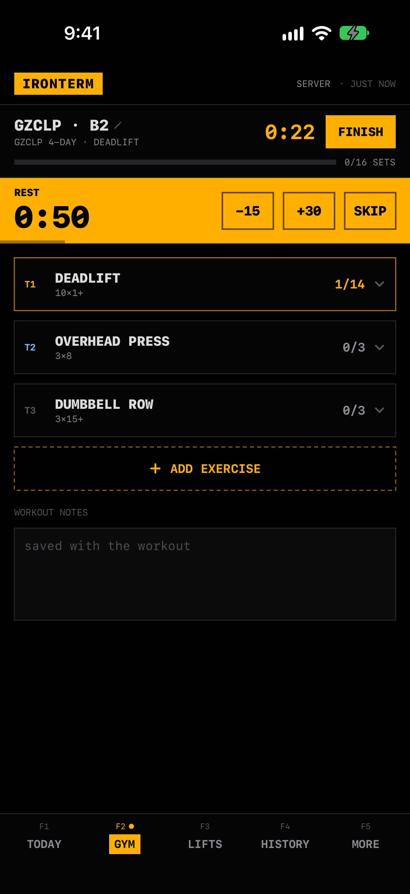
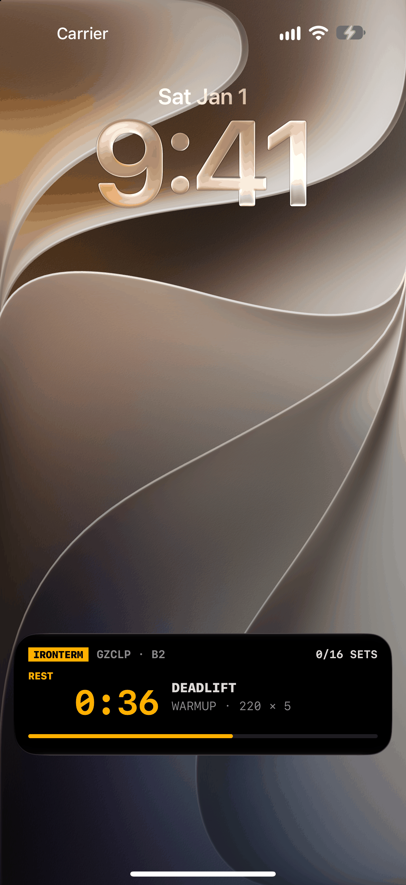
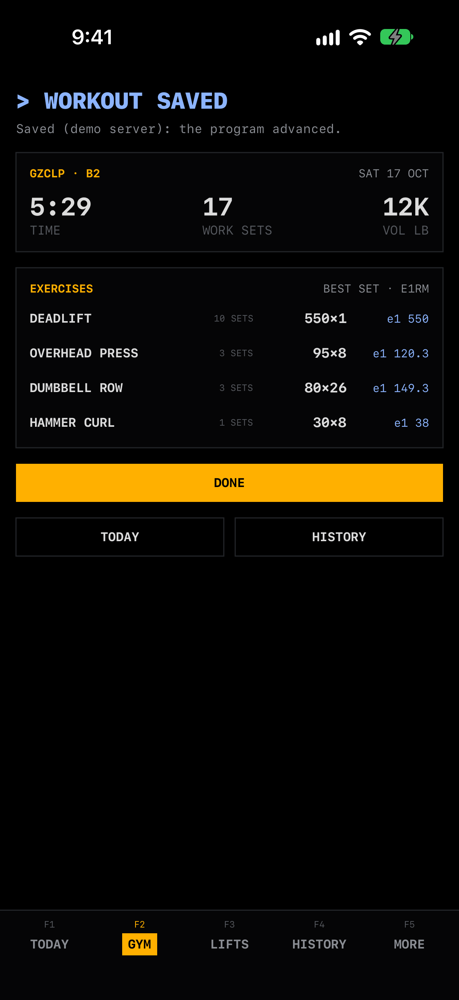

# Ironterm for iOS

A native SwiftUI app plus home-screen and lock-screen widgets for Ironterm, in the same terminal
style as the web app: black background, monospace type, amber accent, blue graph ramp.

Uses the Hevy public API; not affiliated with Hevy.

| Today | Gym | Lock screen | Finish |
|---|---|---|---|
|  |  |  |  |

More in [docs/screens/ios](../docs/screens/ios).

## Two data sources

You pick one in **SETUP** and can switch at any time.

| | **Server** | **Direct** |
|---|---|---|
| Needs | Your Ironterm server URL + an app token (`ht_…`) | A Hevy API key (hevy.com → Settings → Developer) |
| Reads | `/api/snapshot` and the app screens `/api/app/*` (see [docs/api](../docs/api/README.md#app-screens)) | `api.hevyapp.com/v1/workouts`, 10 per page |
| TODAY, graph, streak, this week, e1RM table | ✓ | ✓ computed on the phone |
| LIFTS list + detail, HISTORY + workout detail | ✓ | ✓ from the cached workouts (no stall / projection / RPE chart) |
| GYM (log a workout, rest timer, Live Activity) | ✓ | — needs a server (it writes to Hevy through the program) |
| CALENDAR, PROGRAM, BODY, INSIGHTS, STATS, readiness, watch list, PRs | ✓ | — shows "needs a server" |
| EDIT NOTES, PUSH TO HEVY | ✓ | — |

Direct mode settings: unit (kg/lb) and the sessions per week the streak counts. The first Direct
sync reads every workout; after that the app and widgets fetch only new pages. **FULL RESYNC**
re-reads everything (picks up deletions).

## Connecting to a server

1. In the web app: **F10 SETUP → APPS & WIDGETS → New app token**.
2. Connect the phone, any of three ways. Each ends in the same confirmation sheet showing the
   server, and nothing is saved until you tap CONNECT:
   - **Scan the QR code**: SETUP → **SCAN QR** (shown at the top while not connected, and in the
     Server section). It uses VisionKit's live scanner, or an AVFoundation scanner where that isn't
     available, and asks for camera access the first time. The code contains exactly the connect
     link below; anything else shows *That QR isn't an Ironterm connect code.* Devices without a
     usable camera (and the simulator) show the button disabled with a hint. The system Camera app
     also opens the code, since it is an `ironterm://` link.
   - **Open in app** on the phone itself, which opens
     `ironterm://connect?server=<urlencoded origin>&token=<ht_…>`.
   - **Manually**: paste the URL and token into SETUP, tap **TEST**, then **SAVE & SYNC**.

A revoked token shows *Token revoked or invalid. Reconnect.* with a button to SETUP; the last
synced data stays visible. Plain `http://` works for LAN addresses (`NSAllowsLocalNetworking`);
public servers need https.

## The app

The server computes, the app renders: every screen is one JSON document from `GET /api/app/…`
(types in `web/shared/appapi.ts`, mirrored in `Ironterm/API/AppModels.swift`). The last good copy of
each is cached, so screens open instantly and work offline (an amber OFFLINE strip says how old it is).
Only the live gym session logic runs on the phone.

Bottom bar: **TODAY · GYM · FRIENDS · HISTORY · MORE** (LIFTS is the first entry under MORE).

- `F1 TODAY` session in progress, next session (tap → GYM), this week, 26-week graph, readiness,
  e1RM table (now, 4 and 12 week change, best), watch list (stalls and progress), recent PRs,
  26 weeks of volume, last workout.
- `F2 GYM` the logger.
  - Start the next program day, pick another day, start an empty workout, or resume one started
    on the web (the session touched last wins).
  - One card per exercise; the set to do next is highlighted with big steppers (load step by lift
    kind) and a tap-to-type number pad. Set types (normal / warmup / failure / drop) and RPE from the
    set number's menu, + SET, remove set / exercise, warmups before T1 lifts, back-offs filled in from
    the top set, a plate loader (bar weight in SETUP), program notes (▲ if you hit it, ▼ if you
    miss), your exercise note and the workout note, and a searchable exercise catalog with cardio.
  - Header: rename, elapsed clock, progress. The rest timer (−15 / +30 / SKIP) also runs as a
    **Live Activity** on the lock screen and in the Dynamic Island, with a local notification and
    haptics when it ends. The screen stays awake while a session runs.
  - **Offline first**: every change is written to a file on the phone at once and sent to the
    server (`PUT /api/live`) debounced. FINISH (`POST /api/live/finish`, idempotent per session) and
    DISCARD are queued while offline and sent in order when back; a strip shows workouts waiting to
    upload. Starting offline builds the day from the cached plan exactly like the server would.
    DISCARD asks first. After FINISH: a summary with time, sets, volume, best set and e1RM per
    exercise, and the records set.
- `F3 FRIENDS` friends on other people's Ironterm servers (protocol: [docs/social/PROTOCOL.md](../docs/social/PROTOCOL.md);
  the app only calls its own server's `/api/social/*`). Server mode only; Direct mode shows "needs a server".
  - **Setup** card: handle, display name, directory listing, and what is (and isn't) shared. The person icon edits it
    later (key fingerprint, remove from directory).
  - **FEED**: sessions, PRs and achievements from every friend, newest first, paged with `before`. Reaction chips
    from the fixed set 💪 🔥 👏 🏆 😤 (tap again to remove, another one replaces it; optimistic, rolled back if the
    server refuses), comments, pull to refresh (`?fresh=1`), a small CACHED mark on friends served from the
    server's cache and a note for unreachable ones.
  - **FRIENDS**: incoming requests (accept with a BASIC / LIFTS / FULL picker that explains each level, or reject),
    friends (what you share, what they share), sent requests (cancel). **+ ADD FRIEND**: directory search, or a
    handle / server URL, an optional note (≤140) and the share level.
  - **Friend profile**: 53-week graph (levels only), streak, this week, lifts, program; SHARING changes the level or
    unfriends (asks first); **COMPARE** shows e1RM side by side (× bodyweight when both share it), training days per
    week for 12 weeks (Swift Charts) and the streaks. Their own feed below.
  - **MINE**: your own items with the reactions and comments friends left. The **bell** lists requests, reactions and
    comments with an unread badge (also a dot on the tab); MARK ALL READ, or leaving the list marks it read. When the
    app refreshes and finds new ones it posts a local notification (only if notifications are already allowed).
  - The last good copy of everything is cached, so the tab opens offline with the amber OFFLINE strip.
- `LIFTS` (under MORE) every tracked lift with a sparkline; detail: Swift Charts e1RM (each session and the
  28-day best) with the 12-week projection band and drag-to-scrub, trend / stall, projection, rep
  PRs, PR wall (how long each record has stood), your RPE chart, recent sessions.
- `F4 HISTORY` infinite list with search; workout detail (sets, e1RM, how the program counted it);
  **EDIT NOTES** (`PUT /api/workouts/{id}/notes`).
- `F5 MORE`
  - **CALENDAR** month grid (done / planned / missed / travel) with a day sheet.
  - **PROGRAM** slots with what happens next, upcoming sessions, decision log, **PUSH TO HEVY**.
  - **BODY** front and back muscle maps (readiness or weekly load) drawn natively from the server's
    SVG with a small SVG path renderer (`Ironterm/Body/SVG.swift`, no WebView), plus the muscle list.
  - **INSIGHTS** projections, strength balance, achievements.
  - **STATS** totals, 53-week graph, weekly volume / sessions / sets.
  - **SETUP** source, credentials, QR, test, sync, **gym preferences** (rest alert, Live Activity,
    haptics, keep screen on, auto-advance, bar weights), graph theme, widget gallery, and
    **Advanced setup (web)**: program choice and lift mapping open the web app in Safari
    (SFSafariViewController), the only web surface.

Credentials are stored in the Keychain (access group = the App Group, so the widgets can read
them, `AfterFirstUnlockThisDeviceOnly`). The last snapshot is cached in the App Group container so
widgets work offline.

## Widgets

All widgets fetch on their own about every 30 minutes (they share one network request), and the
app reloads them after every sync. Tapping a widget opens the matching tab.

| Widget | Sizes | Options |
|---|---|---|
| **Activity** | small (14 weeks), medium (26 weeks + stats), large (53 weeks in two bands + stats + last workout), extra large on iPad (53 weeks + stats + week + big four) | theme: same as app / Blue (Terminal) / Green / Purple / Orange |
| **Next workout** | small (day, when, top 3 lifts), medium (every exercise), large (+ week strip) | — |
| **This week** | small (done/target ring + streak), medium (Mon–Sun strip + volume) | — |
| **Lifts** | small (one lift + sparkline + Δ), medium (big four), large (up to 8) | which lift (small) |
| **Recovery** | small (overall gauge), medium (least-ready bars) | Direct mode shows "needs server" |
| **Lock screen** | circular (week ring or streak), rectangular (next workout), inline ("Next: Bench 325 · TOMORROW") | circle shows week / streak |

The **GYM Live Activity** (`IrontermWidgets/GymLiveActivity.swift`) shows the rest countdown (or the
session clock), the set to do next and progress, on the lock screen and in the Dynamic Island.

Every widget is previewed in **SETUP → WIDGET GALLERY** (your data, the server demo, or the
Direct demo). Renders of each size are in [docs/screens/ios/widgets](../docs/screens/ios/widgets).

## Run it on an iPhone with a free Apple ID

1. Open `ios/Ironterm.xcodeproj` in Xcode (26 or later; the project uses folder-synchronised
   groups).
2. Xcode → Settings → Accounts → add your Apple ID.
3. Select the **Ironterm** target → *Signing & Capabilities* → Team = *your name (Personal Team)*.
   Do the same for **IrontermWidgets** (and **IrontermTests** if you run tests on the device).
4. A free team can't use someone else's identifiers, so change the bundle ids to something unique,
   e.g. `com.yourname.ironterm` and `com.yourname.ironterm.widgets`, and the App Group in both
   targets' *App Groups* capability (and `Store.appGroup` in `Shared/Data/Store.swift`) to
   `group.com.yourname.ironterm`. The widget's id must start with the app's id.
5. Plug in the phone, pick it as the run destination, ⌘R. On the phone: Settings → General →
   VPN & Device Management → trust your developer certificate. Developer Mode must be on
   (Settings → Privacy & Security → Developer Mode).

Free provisioning profiles expire after 7 days; run from Xcode again to refresh. If Xcode refuses
the App Groups capability on a personal team, the app still works but widgets can't see the app's
data (they'll say NOT CONNECTED).

## Development

```sh
cd ios
# build + unit tests on a simulator
xcodebuild -project Ironterm.xcodeproj -scheme Ironterm \
  -destination 'platform=iOS Simulator,name=<any iPhone simulator>' CODE_SIGNING_ALLOWED=NO test

# also write every widget render to docs/screens/ios/widgets and run the live mock-server test
python3 Tools/mock_server.py 8787 &
TEST_RUNNER_SCREENSHOT_DIR=$PWD/../docs/screens/ios/widgets \
TEST_RUNNER_MOCK_SERVER=http://127.0.0.1:8787 \
xcodebuild … test
```

- Unit tests: the live-session port replays golden cases generated from `web/shared/live.ts`
  (`IrontermTests/Fixtures/live_golden.json`), every app document decodes from the server samples
  (copies of `docs/api/app/*.json`), the offline queue and GymStore against an in-process stub server,
  the SVG path parser and body figures, and Direct-mode LIFTS / HISTORY.
- Against a real server: `cd web && PORT=8791 HOST=127.0.0.1 DATA_DIR=$(mktemp -d) SYNC_MINUTES=0 node dist/server/main.mjs`,
  `POST /api/tokens {"name":"sim"}`, then `xcrun simctl openurl booted "ironterm://connect?server=http%3A%2F%2F127.0.0.1%3A8791&token=…"`.
  The no-login demo server only answers requests to 127.0.0.1 / localhost.
- `Tools/mock_server.py` is a minimal stand-in for the snapshot endpoint: `/api/snapshot` and `/api/sync` require
  `Bearer ht_test_good` (anything else is 401).
  Connect to it with `ironterm://connect?server=http%3A%2F%2F127.0.0.1%3A8787&token=ht_test_good`.
- Launch arguments for screenshots (no network, no stored data touched): `-demoFixture`,
  `-demoDirect`, `-demoEmpty`, `-demoError 401`, `-demoLink`, `-demoServer <origin>`,
  `-startTab today|gym|friends|history|more|lifts|calendar|program|body|insights|stats|setup|gallery`.
  FRIENDS uses an in-memory demo backend: `-demoSocial setup|empty|error|offline` and
  `-socialScreen feed|friends|mine|add|accept|notifications|setup|profile|compare|share|comments`
  (screenshots: `docs/screens/ios/social-*.png`; `social-live-*.png` are from two real local servers).
  The same names work as `ironterm://tab/<name>` links (widgets use them).
- The app icon is generated by `../docs/brand/make_icons.py` (one script for iOS, Android and the web). `Shared/Data/LiftLibrary.swift` is generated from
  `web/shared/lifts.ts`.
- Layout: `Shared/` (models, Direct aggregation, networking, widget views, the live-session port
  `Shared/Gym/Live.swift` and the Live Activity attributes; built into the app and the extension),
  `Ironterm/` (app: `API/`, `Gym/`, `Screens/`, `Body/`, `Direct/`, `UI/`), `IrontermWidgets/`
  (widget extension + Live Activity), `IrontermTests/`.
- CI builds with Xcode 16 / Swift 6.1: keep Double / CGFloat arithmetic explicitly typed and guard
  anything newer than iOS 17 with `#available`.
- The product name lives in `Shared/Brand.swift` and the `APP_DISPLAY_NAME` build setting.
